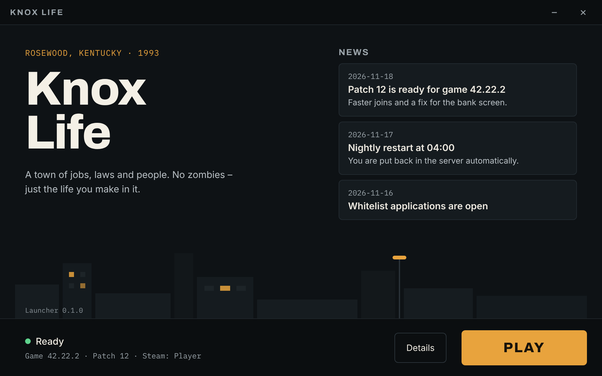

# Knox Life launcher

The launcher for **Knox Life**, a roleplay server for Project Zomboid (Build 42), and the player side of the
Java mods the server uses.

The code is public so you can check exactly what runs on your PC. It is **not** open source: all rights are
reserved (see [LICENSE](LICENSE)).

> Status: in development. Nothing here is released yet.



More screenshots (with example news): [Details](docs/vinduet/details.png),
[downloading](docs/vinduet/laster-ned.png), [new game version](docs/vinduet/ny-spillversjon.png),
[no connection](docs/vinduet/uten-nett.png), [game not found](docs/vinduet/uten-spillet.png).

## What the launcher does when you press Play

1. **Cleans up first.** If the launcher was closed while the game was running (crash, power cut), it puts the game
   files back before doing anything else.
2. **Refuses to patch a running game.** The patch can only be added before Java starts.
3. **Downloads the manifest and checks its signature** (ed25519) against the public key built into the launcher, before
   reading anything in it. The manifest's address is built in, and the launcher never accepts a build older than the
   newest one it has seen.
4. **Checks the game version.** The SHA-256 of your `projectzomboid.jar` must be exactly the one the patch was built
   for. If the game has updated and the patch is not ready, the launcher says so and does not start. There is no way
   around this: a patch that does not match fails silently.
5. **Downloads the patch** to the launcher's own folder (never into the game folder) and checks every file against the
   SHA-256 in the manifest.
6. **Adds the patch** by changing one file, after saving a copy of it:
   - Windows and Linux: `-javaagent:…/knoxlife-agent.jar` first in `vmArgs` in `ProjectZomboid64.json`.
   - macOS: the agent is copied into `Project Zomboid.app/Contents/Java/knoxlife/` and listed first in `JVMOptions` in
     `Contents/Info.plist`.
7. **Starts the game through Steam**, waits for the agent to report that it loaded, and watches the game.
8. **Puts everything back** when the game closes: the copy is written back byte for byte, and the files it added are
   removed.

## What the launcher never does

- Ask for a password or log in to anything. Your identity is your Steam account, which the game already checks.
- Run as administrator.
- Send data about you or your PC anywhere. The error report is only copied when you press "Copy report", and you paste
  it yourself.
- Replace or keep any of the game's files.
- Load anything from the internet into the window. The news comes inside the signed manifest and is shown as plain
  text.

To remove everything: uninstall the launcher. The game folder is untouched while the game is not running. "Restore game
files" in Details, or Steam's "Verify integrity of game files", puts back anything left behind.

## Layout

| Folder | What |
|---|---|
| `launcher/app` | The launcher's window (Tauri): Play, the news, the status line and Details. It only shows what the core does and calls it |
| `launcher/kjerne` | The launcher's core, without a window or network: finding the game, the manifest, the version check, the download check, adding and removing the patch, and watching the game |
| `launcher/knoxctl` | The same steps on the command line, for testing and troubleshooting |
| `java/agent` | The Java agent (`knoxlife-agent.jar`): starts Mixin with our Java mods before the game's classes load, writes the stamp the launcher waits for, reads the travel ticket, and makes the anti-cheat report the server checks at login |

Code comments and names are in Norwegian; everything players see is in English.

## What the agent reports at login

The server only lets in players whose game was started by the launcher. The agent looks at the Java the game runs in
and lists what does not belong there: other `-javaagent`, native agents and debuggers, a changed boot class path or
class loader, Java options in environment variables, extra files on the class path, class files in folders on the class
path, and whether tools can attach to the game after it has started. It sends at most 8 findings, each at most 96
characters, with **file names only – never folder paths**, so nothing about your folders or user name leaves your PC.

## Back in after a restart

When the connection to Knox Life drops – the server restarts, or the network or the server goes down – the game shows
"Server restarting" (or "Connection to Knox Life lost") for 3 seconds, goes to the main menu by itself and joins the
same server again through the game's own connect screen, every 15 seconds for up to 15 minutes. Press "Abort" on that
screen to stop. Nothing happens if you were kicked or banned, or on any other server.

To join again, the game uses the login it already has in memory from when you joined (the password as the game stores
it after hashing). It is never written to disk or to any log.

When staff send you to the Knox Life test server, the game goes to the main menu and joins it the same way. It only
ever goes to servers listed in the launcher's signed manifest.

## Performance

The agent can time the Lua functions that mods run on game events, to find what makes the game slow. On your PC it is
off. Staff can turn it on for a few minutes when you report lag; it then records which mod file and line took how long
and how many frames were slow – nothing about you, your folders or your PC – and the mod sends that to the server.

The server can also give the game a list of event functions to skip, for mod functions that only matter with zombies.
Every entry names the mod, the file and the line, with the reason.

## Building and testing

```sh
cd launcher
cargo test
cargo build --release -p knoxctl
cargo run -p knoxlife-launcher   # the window; on Linux it needs WebKitGTK 4.1 (libwebkit2gtk-4.1-dev)

java/agent/bygg.sh   # JDK 21+, curl and sha256sum (Git Bash on Windows)
```

`bygg.sh` downloads Mixin, MixinExtras and ASM from Maven Central, checks each against the SHA-256 in
`java/agent/libs.lock`, runs the tests, builds `knoxlife-agent.jar`, and finally starts a small stand-in game with the
agent and a test mod to check that Mixin really changes the game's code as it loads. The jar has fixed timestamps and a
fixed file order, so the same code and JDK give the same bytes: compare its SHA-256 with the file the launcher
downloads.

The Java mods themselves (`java/agent/mods/`) are compiled against the game's own jar, so they are only built when you
point the build at a folder with `projectzomboid.jar` (with Java 25, the game's version):

```sh
SPILLETS_MAPPE="<folder with projectzomboid.jar>" java/agent/bygg.sh
```

That build also starts the agent against the real game and loads every class in it. If one of our mods no longer fits
the game (a method was renamed, a class is gone), the build stops. GitHub does this on every change, with the game
fetched from Steam's dedicated server; the game's files are never stored or published here.

A new version of the game can also change a method without renaming it, so the mod still fits but does something
different. The drift check catches that: `java/agent/avdrift.txt` holds a fingerprint (SHA-1 of the instructions) of
every game method our mods touch, and the build stops when one of them has changed, until someone has read the new
method and checked the mod. The build then prints what the file should be; `AVDRIFT=lag` writes it.

`knoxctl finn` shows where the game is, `knoxctl status` whether the patch is in, and `knoxctl sett-tilbake` puts the
game back.
